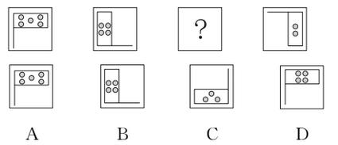

# Mathematics (Grade 6)

**ID**: e339920d
**难度**: medium_hard
**题型**: multiple_choice

## 题目
下图是按照一定的规律排列起来的。“？”处的图形应是（）

## 解答

**答案**: C

1. Step1:观察图形，确定图形由旗子和旗子上的小圆点构成
2. Step2:分析相邻图形中旗子的变化规律，得出旗子每次逆时针旋转90°
3. Step3:分析相邻图形中小圆点的变化规律，得出小圆点个数依次减少1
4. Step4:根据上述规律，对“？”处图形进行推理，与各选项对比，得出答案为C

## 知识点

**知识点**:
  - 图形中的规律

---
