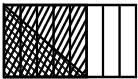

# Mathematics (Grade 6)

**ID**: e4387d22
**难度**: medium_hard
**题型**: multiple_choice

## 题目
如图中长方形的面积是32平方厘米，那么双阴影部分的面积是(  )平方厘米．
A．16
B．20
C．10

## 解答

**答案**: C

1. Step1:根据图中信息，确定单阴影部分占长方形的比例为$\frac{5}{8}$
2. Step2:因为长方形面积是32平方厘米，所以计算单阴影部分面积为32×$\frac{5}{8}$平方厘米
3. Step3:已知双阴影部分占单阴影部分的$\frac{1}{2}$，得出双阴影部分面积为32×$\frac{5}{8}×\frac{1}{2}$平方厘米
4. Step4:计算32×$\frac{5}{8}×\frac{1}{2}$=20×$\frac{1}{2}$=10平方厘米
5. Step5:对比选项，答案为C

## 知识点

**知识点**:
  - 分数乘法应用题．

---
