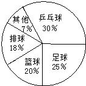

# Mathematics (Grade 6)

**ID**: e4741f59
**难度**: medium_hard
**题型**: multiple_choice

## 题目
某校对300名学生最喜欢的球类进行了调查，最喜欢篮球的有(  )人．

A．50
B．60
C．90
D．75

## 解答

**答案**: B

1. Step1:明确题目给出总人数为300名学生
2. Step2:从扇形统计图中获取最喜欢篮球的人数所占百分率为20%
3. Step3:根据‘求一个数的百分之几是多少，用乘法’，计算最喜欢篮球的人数，即300×20% = 60人
4. Step4:对比选项，找到答案为B

## 知识点

**知识点**:
  - 扇形统计图．

---
