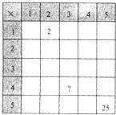

# Mathematics (Grade 6)

**ID**: e515144f
**难度**: medium_hard
**题型**: multiple_choice

## 题目
观察下表，其中2=1×2，25=5×5，那么“？”处的数应填（  ）

$\begin{description}
\item A．4\item B．7\item C．12\item D．16
\end{description}$

## 解答

**答案**: C

1. Step1:分析题目所给示例，2 = 1×2 是第1行第2列对应数字，25 = 5×5 是第5行第5列对应数字，总结规律为表格中某位置的数字等于其所在的行数乘所在的列数。
2. Step2:确定“？”所在位置为第4行第3列。
3. Step3:根据上述规律计算“？”处数字，即 4×3 = 12。
4. Step4:对比选项，发现12对应的选项为C。

## 知识点

**知识点**:
  - 整数的乘法及应用．

---
