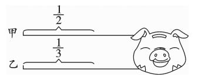

# Mathematics (Grade 6)

**ID**: e7021d62
**难度**: medium_hard
**题型**: multiple_choice

## 题目
小猪遮住了甲、乙的一部分，原来的甲、乙相比（）。

A.甲、乙一样长
B.甲比乙长
C.乙比甲长

## 解答

**答案**: C

1. Step1:根据图中信息得出甲数×$\frac{1}{2}$=乙数×$\frac{1}{3}$
2. Step2:根据比例的性质，由甲数×$\frac{1}{2}$=乙数×$\frac{1}{3}$，可得$\frac{甲数}{乙数}$=$\frac{1}{3}÷\frac{1}{2}$
3. Step3:计算$\frac{1}{3}÷\frac{1}{2}$=$\frac{1}{3}$×$\frac{2}{1}$=$\frac{2}{3}$
4. Step4:因为$\frac{甲数}{乙数}$=$\frac{2}{3}$＜1，所以甲数小于乙数，即乙比甲长

## 知识点

**知识点**:
  - 分数的认识;分数的除法

---
