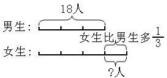

# Mathematics (Grade 6)

**ID**: e793a4c7
**难度**: medium_hard
**题型**: multiple_choice

## 题目
根据图意列式正确的是（  ）
A．18×(1+$\frac{1}{3}$
B．18×$\frac{1}{3}$
C．x(1+$\frac{1}{3}$=18

## 解答

**答案**: B

1. Step1:明确题目要求是找出表示女生比男生多的人数的正确列式
2. Step2:已知男生人数为18人，且女生比男生多的人数是男生人数的$\frac{1}{3}$
3. Step3:根据求一个数的几分之几是多少用乘法，可知女生比男生多的人数列式为18×$\frac{1}{3}$
4. Step4:对比选项，得出答案为B

## 知识点

**知识点**:
  - 分数乘法应用题．

---
