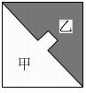

# Mathematics (Grade 6)

**ID**: e84fc788
**难度**: medium_hard
**题型**: multiple_choice

## 题目
图中甲、乙两部分的（）

A.周长和面积都相等
B.周长相等，面积不等
C.周长不等，面积相等

## 解答

**答案**: B

1. Step1:明确周长是围成图形一周的长度，面积是平面图形所占平面的大小
2. Step2:分析得出甲的周长等于长方形相邻两边的和加上中间线段的长
3. Step3:分析得出乙的周长等于长方形相邻两边的和加上中间线段的长
4. Step4:因为长方形对边相等，所以甲和乙两部分的周长相等
5. Step5:通过观察图形，得出甲的面积大于乙的面积
6. Step6:根据周长和面积的比较结果，确定答案为B

## 知识点

**知识点**:
  - 巧算周长(奥数);三角形的面积

---
