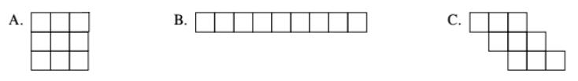

# Mathematics (Grade 6)

**ID**: e910a36c
**难度**: medium_hard
**题型**: multiple_choice

## 题目
下面各图是由同样大小的9个正方形拼成的，（）的周长最短。

## 解答

**答案**: A

1. Step1:将小正方形的边长看成1
2. Step2:数出图形A一周的小正方形边长有12个，所以A的周长是12
3. Step3:数出图形B一周的小正方形边长有20个，所以B的周长是20
4. Step4:数出图形C一周的小正方形边长有16个，所以C的周长是16
5. Step5:比较12、20、16的大小，可得12<16<20
6. Step6:得出A的周长最短，答案为A

## 知识点

**知识点**:
  - 周长的认识

---
