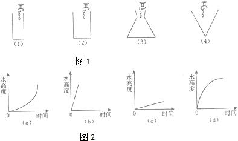

# Mathematics (Grade 6)

**ID**: eb6f4014
**难度**: medium_hard
**题型**: multiple_choice

## 题目
如图1是水滴进入玻璃容器的示意图（滴水速度相同），如图2第二行表示的是容器中水的高度随滴水时间变化的情况（图中刻度、单位都相同）．下列对应中正确的是（  ）

A．（1）-（a）
B．（2）-（b）
C．（3）-（c）
D．（4）-（d）

## 解答

**答案**: D

1. Step1:分析（1），容器是规则圆柱体，水的深度随时间均匀沿直线上升，应对应（b），所以A选项（1）-（a）错误
2. Step2:分析（2），容器是规则圆柱体，水的深度随时间均匀变化且比（1）上升慢，应对应（c），所以B选项（2）-（b）错误
3. Step3:分析（3），容器下宽上窄，水的深度上升先慢后快，图形为先缓后陡，应对应（a），所以C选项（3）-（c）错误
4. Step4:分析（4），容器下窄上宽，水的深度上升先快后慢，图形为先陡后缓，对应（d），所以D选项（4）-（d）正确

## 知识点

**知识点**:
  - 单式折线统计图；从统计图表中获取信息．

---
