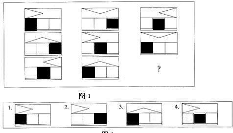

# Mathematics (Grade 6)

**ID**: eb8f6bec
**难度**: medium_hard
**题型**: multiple_choice

## 题目
解答题

请你根据图1两排图案的排列规律，从图2四个图案中选一个适当的填在“？”处．

## 解答

**答案**: 2

1. Step1:观察前两行图案中三角形的放置位置，发现其顺序为左、上、右、下、左、上。
2. Step2:观察前两行图案中正方形涂黑的位置，发现其顺序为左、右、中、右、中、左、中、左。
3. Step3:根据上述规律，确定“？”处图案上面应是左三角形，下面应是右面正方形涂黑。
4. Step4:对比图2中的四个图案，判断只有图案2符合“？”处应有的特征。

## 知识点

**知识点**:
  - 事物的简单搭配规律．

---
