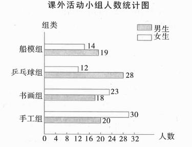

# Mathematics (Grade 6)

**ID**: ec1d2465
**难度**: medium_hard
**题型**: multiple_choice

## 题目
下面是华清小学的课外活动小组人数统计图。

这四个课外活动小组中，人数最多的是（）。
A.船模组
B.乒乓球组
C.书画组
D.手工组

## 解答

**答案**: D

1. Step1:计算船模组人数，14 + 19 = 33人
2. Step2:计算乒乓球组人数，12 + 28 = 40人
3. Step3:计算书画组人数，23 + 18 = 41人
4. Step4:计算手工组人数，30 + 20 = 50人
5. Step5:比较四个组人数大小，33＜40＜41＜50
6. Step6:得出人数最多的是手工组，对应选项为D

## 知识点

**知识点**:
  - 单式条形统计图

---
