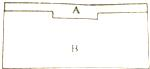

# Mathematics (Grade 6)

**ID**: ec434d19
**难度**: medium_hard
**题型**: multiple_choice

## 题目
如图，A、B两个图形周长的关系是（  ）

A．A的周长大
B．B的周长大
C．相等

## 解答

**答案**: B

1. Step1:观察图形，确定图形A和图形B有共同的折线部分
2. Step2:对比图形A和图形B横着的边长，发现二者相等
3. Step3:对比图形A和图形B竖着的边长，得出A的竖着边长小于B的竖着边长
4. Step4:根据周长是图形各边长度之和，由于横着边长和共同折线部分长度都相等，仅竖着边长A＜B，所以图形A的周长＜图形B的周长
5. Step5:根据选项，选择答案B

## 知识点

**知识点**:
  - 长度比较．

---
