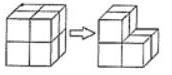

# Mathematics (Grade 6)

**ID**: ec53ab00
**难度**: medium_hard
**题型**: multiple_choice

## 题目
从大正方体中取走两个小正方体（如图所示），小正方体的棱长是4cm，取走后表面积和原来相比减少了（   ）
 $cm^{2}$

  A
  ．
  32
  B．64
  C．96
  D．128

## 解答

**答案**: A

1. Step1:明确问题是求取走两个小正方体后表面积比原来减少的数值
2. Step2:根据观察得知表面积减少的部分是两个小正方体的面
3. Step3:因为小正方体棱长为4cm，所以一个面的面积为4×4 = 16平方厘米
4. Step4:计算减少的总面积为一个面的面积乘以减少的面的数量，即16×2 = 32平方厘米
5. Step5:对比选项，得出答案为A

## 知识点

**知识点**:
  - 期中验收标准检测

---
