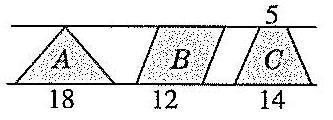

# Mathematics (Grade 6)

**ID**: ef159929
**难度**: medium_hard
**题型**: multiple_choice

## 题目
比较图中A、B、C的面积，可以得出（   ）

 A．A的面积最小
 B．B的面积最小
 C．C的面积最小

## 解答

**答案**: A

1. Step1:设图中A、B、C的高都为5
2. Step2:根据三角形面积公式S = 底×高÷2，计算A的面积为18×5÷2 = 45
3. Step3:根据平行四边形面积公式S = 底×高，计算B的面积为12×5 = 60
4. Step4:根据梯形面积公式S = (上底 + 下底)×高÷2，计算C的面积为(5 + 14)×5÷2 = 47.5
5. Step5:比较三个图形面积大小，45＜47.5＜60，得出A的面积最小

## 知识点

**知识点**:
  - 单元全练全测;第六、七单元全练全测

---
