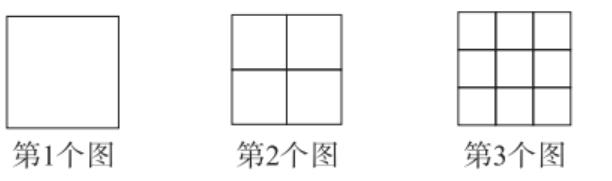

# Mathematics (Grade 6)

**ID**: f250d68a
**难度**: medium_hard
**题型**: multiple_choice

## 题目
观察下面图形，我们可以发现：第1个图中有1个正方形，第2个图中共有5个正方形，第3个图中共有14个正方形，按此规律，第5个图中共有（）个正方形。

A.54
B.55
C.58

## 解答

**答案**: B

1. Step1:分析第1个图，可知其中有1个正方形
2. Step2:分析第2个图，其正方形个数为2×2 + 1 = 5个
3. Step3:分析第3个图，其正方形个数为3×3 + 5 = 14个
4. Step4:根据前面规律，推出第4个图的正方形个数为4×4 + 14 = 30个
5. Step5:按照规律计算第5个图的正方形个数为5×5 + 30 = 55个
6. Step6:对比选项，答案为B

## 知识点

**知识点**:
  - 图形中的规律

---
