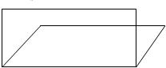

# Mathematics (Grade 6)

**ID**: f25f5898
**难度**: medium_hard
**题型**: multiple_choice

## 题目
把一个长方形木架拉成一个平行四边形，平行四边形的周长与长方形的周长相比一样大，平行四边形的面积与长方形的面积相比(  )
A．长方形大
B．平行四边形大
C．一样大
D．无法确定

## 解答

**答案**: A

1. Step1:设长方形的长为a，宽为b，根据长方形面积公式可得长方形的面积为ab
2. Step2:长方形拉成平行四边形后，底不变仍为a，设此时高为c，由平行四边形面积公式可知平行四边形的面积为ac
3. Step3:因为拉伸过程中宽变成平行四边形的斜边，所以宽b大于高c，即b＞c
4. Step4:由于a为正数，b＞c，根据不等式性质可得ab＞ac，即长方形面积大于平行四边形面积，所以答案选A

## 知识点

**知识点**:
  - 面积及面积的大小比较．

---
