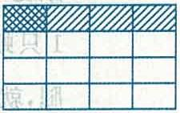

# Mathematics (Grade 6)

**ID**: f44e848a
**难度**: medium_hard
**题型**: multiple_choice

## 题目
图中表示的是（    ）。

$A.\,\frac{3}{4}×\frac{1}{4}$
$B.\,\frac{1}{4}×\frac{1}{4}$
$C.\,\frac{1}{2}×\frac{1}{4}$

## 解答

**答案**: B

1. Step1:观察图形，先看到长方形被平均分成了4份，其中1份被涂色，根据分数的意义，这1份占整个长方形的比例为$rac{1}{4}$
2. Step2:再看涂色的这1份又被平均分成了4份，其中更小的1份占这涂色1份的比例为$rac{1}{4}$
3. Step3:那么图中表示的就是$rac{1}{4}$的$rac{1}{4}$，即$rac{1}{4}×rac{1}{4}$
4. Step4:对比选项，选项B为$rac{1}{4}×rac{1}{4}$，所以答案是B

## 知识点

**知识点**:
  - 期末综合测试卷-
-

---
