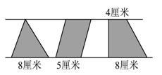

# Mathematics (Grade 6)

**ID**: f455709b
**难度**: medium_hard
**题型**: multiple_choice

## 题目
下图中，平行线间三个图形的面积相比，（    ）。 

$\begin{description}
\item A.三角形的面积最大\item B.平行四边形的面积最大\item C.梯形的面积最大\item D.不能确定谁的面积最大
\end{description}$

## 解答

**答案**: C

1. Step1:明确三角形面积公式为底×高÷2，平行四边形面积公式为底×高，梯形面积公式为（上底＋下底）×高÷2
2. Step2:因为平行线间的距离处处相等，设三个图形的高都为h
3. Step3:根据公式计算三角形面积为8h÷2 = 4h平方厘米
4. Step4:根据公式计算平行四边形面积为5h平方厘米
5. Step5:根据公式计算梯形面积为(4 + 8)h÷2 = 12h÷2 = 6h平方厘米
6. Step6:比较三个图形面积大小，6h＞5h＞4h，得出梯形面积最大

## 知识点

**知识点**:
  - 

---
