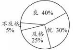

# Mathematics (Grade 6)

**ID**: f4ec5383
**难度**: medium_hard
**题型**: multiple_choice

## 题目
右图是某班一次测验成绩的扇形统计图，其中得优的有12人，则全班共有（）。

A.10人        
B.30人         
C.40人

## 解答

**答案**: C

1. Step1:观察扇形统计图，明确得优的人数为12人
2. Step2:从扇形统计图中获取得优人数占全班人数的比例为30%
3. Step3:根据已知部分量（得优人数12人）和其占总量的比例（30%），用除法计算全班人数，即12÷30%
4. Step4:计算12÷30%的结果为40人，所以全班共有40人，答案选C

## 知识点

**知识点**:
  - 扇形统计图

---
