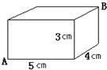

# Mathematics (Grade 6)

**ID**: f4fdb350
**难度**: medium_hard
**题型**: multiple_choice

## 题目
一只蚂蚁从A点沿着一个长方体框架的棱爬到B点，蚂蚁至少爬了（  ）cm．
$\begin{description}
\item A．12\item B．48\item C．60\item D．94
\end{description}$

## 解答

**答案**: A

1. Step1:明确题目要求是求蚂蚁从A点沿着长方体框架的棱爬到B点的最短距离
2. Step2:根据解析2可知，蚂蚁至少应爬一个长、一个宽、一个高
3. Step3:由图可知长方体的长为5cm，宽为4cm，高为3cm
4. Step4:计算至少爬行的距离，即5 + 3 + 4 = 12cm
5. Step5:对比选项，发现A选项为12，所以答案选A

## 知识点

**知识点**:
  - 正方体的特征．

---
