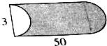

# Mathematics (Grade 6)

**ID**: f59c682d
**难度**: medium_hard
**题型**: multiple_choice

## 题目
如图是农村半圆柱形的蔬菜棚，建造这样一个大棚（两头封堵），大约需要（  ）平方米的塑料布（保留整数）
A．240
B．243
C．254
D．471

## 解答

**答案**: B

1. Step1:明确大棚形状为底面是半圆的半个圆柱体，需求搭建大棚所需塑料薄膜面积，即求圆柱表面积的一半
2. Step2:根据圆柱表面积公式，计算大棚所需塑料布面积的式子为[3.14×3×50 + 3.14×(3÷2)²×2]÷2
3. Step3:先计算中括号内的式子，3.14×3×50 = 471，3.14×(3÷2)²×2 = 14.13，得到(471 + 14.13)÷2
4. Step4:计算(471 + 14.13)÷2 = 485.13÷2
5. Step5:485.13÷2 ≈ 243（平方米），得出答案

## 知识点

**知识点**:
  - 组合图形的面积．

---
