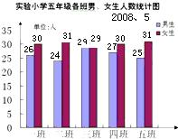

# Mathematics (Grade 6)

**ID**: f6486cc0
**难度**: medium_hard
**题型**: multiple_choice

## 题目
如图所示，从下列复式条形图中获取知识信息不正确的是（  ）

$\begin{description}
\item A．能够知道每个班的男生和女生的人数\item B．能够算出5个班的总人数\item C．男生人数最少的班是5年级5班
\end{description}$

## 解答

**答案**: C

1. Step1:观察复式条形图，可知其纵轴和横轴所表示的条件，能看出每个班的男生和女生的人数，所以A选项正确
2. Step2:因为知道每个班男女生人数，将各班人数相加能够算出5个班的总人数，所以B选项正确
3. Step3:对比各班男生人数，发现男生人数最少的班是5年级2班，并非5年级5班，所以C选项错误

## 知识点

**知识点**:
  - 从统计图表中获取信息．

---
