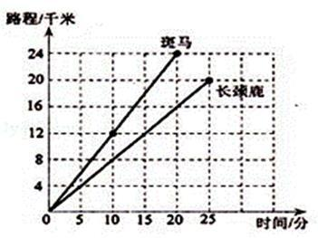

# Mathematics (Grade 6)

**ID**: f6c51e54
**难度**: medium_hard
**题型**: multiple_choice

## 题目
如图所示的统计图表示斑马和长颈鹿的奔跑情况，下面的说法不符合图意的是（ ）。

A．长颈鹿25分钟跑了20千米
B．斑马跑12千米用了10分钟
C．斑马奔跑的速度比长颈鹿快
D．长颈鹿比斑马跑得快

## 解答

**答案**: D

1. Step1:观察统计图，获取长颈鹿的奔跑数据，可知长颈鹿25分钟对应的路程是20千米，所以选项A符合图意
2. Step2:观察统计图，获取斑马的奔跑数据，可知斑马跑12千米对应的时间是10分钟，所以选项B符合图意
3. Step3:根据速度=路程÷时间，计算斑马速度为12÷10 = 1.2千米/分，长颈鹿速度为20÷25 = 0.8千米/分，1.2＞0.8，所以斑马奔跑的速度比长颈鹿快，选项C符合图意
4. Step4:因为斑马速度大于长颈鹿速度，所以长颈鹿比斑马跑得快的说法错误，选项D不符合图意

## 知识点

**知识点**:
  - 小学数学;统计和概率;统计;统计图

---
