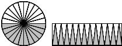

# Mathematics (Grade 6)

**ID**: f818e114
**难度**: medium_hard
**题型**: multiple_choice

## 题目
如图，把一个半径是10cm的圆剪拼成一个近似的长方形，，现在的长方形的周长是（  ）cm．
A．31.4
B．62.8
C．72.8    D、82.8

## 解答

**答案**: D

1. Step1:根据圆的周长公式C = 2πr（其中r为圆半径，π取3.14），计算半径为10cm的圆的周长，即2×3.14×10 = 62.8cm，此为拼成的长方形两个长的长度和
2. Step2:已知圆的半径是10cm，这也就是拼成的长方形的宽
3. Step3:根据长方形周长 = 长×2 + 宽×2，可知长方形周长为圆的周长加上圆半径的2倍，即62.8 + 10×2
4. Step4:计算62.8 + 10×2 = 62.8 + 20 = 82.8cm
5. Step5:对比选项，得出答案为D

## 知识点

**知识点**:
  - 图形的拼组．

---
