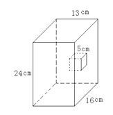

# Mathematics (Grade 6)

**ID**: f90fb11a
**难度**: medium_hard
**题型**: multiple_choice

## 题目
在一个长13cm，宽16cm，高24cm的长方体的一面钻掉一个棱长为5cm的正方体。如下图，它的体积是（  ） 

A．4867cm^{3}
B．5117cm^{3}
C．102694cm^{2}

## 解答

**答案**: A

1. Step1:根据长方体体积公式，计算原长方体体积，即13×16×24=4992 cm³
2. Step2:根据正方体体积公式，计算原正方体体积，即5×5×5=125 cm³
3. Step3:用原长方体体积减去原正方体体积，得到现有图形体积，即4992 - 125=4867 cm³
4. Step4:对比选项，得出答案为A

## 知识点

**知识点**:
  - 

---
