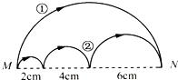

# Mathematics (Grade 6)

**ID**: f9859804
**难度**: medium_hard
**题型**: multiple_choice

## 题目
如图所示，从M到N，走路①与路②的结果是(  )
A．路①远
B．路②远
C．一样远

## 解答

**答案**: C

1. Step1:明确路①的长度计算方法，它是直径为(2+4+6)厘米的半圆的弧长，根据圆的周长公式C = πd（d为直径），其长度为π×(2+4+6)÷2
2. Step2:计算路①的长度，π×(2+4+6)÷2 = 12π÷2 = 6π厘米
3. Step3:明确路②的长度计算方法，它是直径分别为2厘米、4厘米、6厘米的半圆的弧长之和，分别计算各段弧长为2π÷2、4π÷2、6π÷2
4. Step4:计算路②的长度，2π÷2+4π÷2+6π÷2 = π+2π+3π = 6π厘米
5. Step5:比较路①和路②的长度，二者均为6π厘米，得出路①和路②一样长，答案选C

## 知识点

**知识点**:
  - 长度比较;圆、圆环的周长．

---
