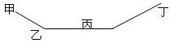

# Mathematics (Grade 6)

**ID**: f9d7187d
**难度**: medium_hard
**题型**: multiple_choice

## 题目
如图，从甲到乙是2千米下坡路，从乙到丙是6千米平路，从丙到丁是5千米上坡路，小张和小王步行，下坡的速度都是每小时6千米，平路的速度都是每小时4千米，上坡的速度都是每小时2千米，小张和小王分别从甲、丁同时出发相向而行，（  ）分钟两人相遇．
A．97.5
B．95
C．80
D．72.5

## 解答

**答案**: C

1. Step1:计算小张从甲到乙的用时，根据时间=路程÷速度，可得2÷6 = $\frac{1}{3}$小时
2. Step2:计算小王从丁到丙的用时，根据时间=路程÷速度，可得5÷6 = $\frac{5}{6}$小时
3. Step3:计算小张比小王早走平路的时间，即$\frac{5}{6}$ - $\frac{1}{3}$ = $\frac{1}{2}$小时
4. Step4:计算小王到达丙地后两人相距的距离，因为平路速度为每小时4千米，所以相距6 - 4×$\frac{1}{2}$ = 4千米
5. Step5:计算两人相遇还需要的时间，根据相遇时间=路程÷速度和，可得4÷(4 + 4) = $\frac{1}{2}$小时
6. Step6:计算两人从出发到相遇总共用的时间，即$\frac{5}{6}$ + $\frac{1}{2}$ = $\frac{4}{3}$小时
7. Step7:将总用时$\frac{4}{3}$小时换算为分钟，1小时=60分钟，$\frac{4}{3}$×60 = 80分钟

## 知识点

**知识点**:
  - 简单的行程问题．

---
