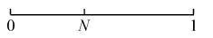

# Mathematics (Grade 6)

**ID**: faa14592
**难度**: medium_hard
**题型**: multiple_choice

## 题目
（    ）算式的得数与N最接近。 

$\begin{description}
\item A.0.3÷0.6\item B.2.5÷5.8\item C.0.3－0.2\item D.0.25×6
\end{description}$

## 解答

**答案**: B

1. Step1:明确N的范围是大于0且小于1，比0.5小且靠近0.5
2. Step2:计算选项A，0.3÷0.6 = 0.5
3. Step3:计算选项B，2.5÷5.8≈0.431
4. Step4:计算选项C，0.3－0.2 = 0.1
5. Step5:计算选项D，0.25×6 = 1.5
6. Step6:比较大小，得到0.1＜0.431＜0.5＜1.5
7. Step7:根据N的范围和靠近0.5的特点，得出2.5÷5.8的得数与N最接近，答案为B

## 知识点

**知识点**:
  - 

---
