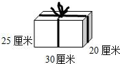

# Mathematics (Grade 6)

**ID**: fb38ae57
**难度**: medium_hard
**题型**: multiple_choice

## 题目
用丝带捆扎一种礼品盒如下，结头处长25厘米，要捆扎这种礼品盒需准备（  ）分米的丝带比较合理．

$\begin{description}
\item A．10分米\item B．21.5分米\item C．23分米\item D．30分米
\end{description}$

## 解答

**答案**: C

1. Step1:根据盒子图可知，丝带长度计算需长乘以2，即30×2 = 60厘米
2. Step2:宽乘以2，即20×2 = 40厘米
3. Step3:高乘以4，即25×4 = 100厘米
4. Step4:将长、宽、高对应的丝带长度相加，60 + 40 + 100 = 200厘米
5. Step5:再加上接头处的长度25厘米，200 + 25 = 225厘米
6. Step6:将225厘米换算成分米，因为1分米 = 10厘米，所以225厘米 = 22.5分米
7. Step7:对22.5分米进行近似取值，22.5分米≈23分米，故选择C选项

## 知识点

**知识点**:
  - 

---
