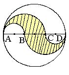

# Mathematics (Grade 6)

**ID**: fbfe4f4b
**难度**: medium_hard
**题型**: multiple_choice

## 题目
下面图形（单位：米）涂色部分的面积是（   ）
AB＝BC＝CD＝4米

$\begin{description}
\item A．12.84平方米\item B．9.24平方米\item C．18.24平方米\item D．37.68平方米
\end{description}$

## 解答

**答案**: D

1. Step1:根据已知条件AB＝BC＝CD＝4米，可知大圆的半径为4米
2. Step2:根据圆的面积公式S = 3.14×r²，计算大圆面积为3.14×4²
3. Step3:观察图形可知空白部分小圆的直径为4米，那么半径为4÷2 = 2米
4. Step4:根据圆的面积公式计算小圆面积为3.14×（4÷2）²
5. Step5:用大圆面积减去小圆面积，即3.14×4²－3.14×（4÷2）²，得到涂色部分面积
6. Step6:计算3.14×4²－3.14×（4÷2）² = 50.24－12.56 = 37.68平方米
7. Step7:将计算结果与选项对比，得出答案为D

## 知识点

**知识点**:
  - 

---
