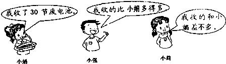

# Mathematics (Grade 6)

**ID**: fd395605
**难度**: medium_hard
**题型**: multiple_choice

## 题目

小强收了多少节？
A．20节
B．48节
C．29节

## 解答

**答案**: B

1. Step1:明确小娟收了30节废电池
2. Step2:根据小强比小娟多得多，可知小强收的废电池节数大于30
3. Step3:分析选项，A选项20节小于30节不符合，C选项29节与30节差不多不符合，B选项48节比30节多得多符合

## 知识点

**知识点**:
  - 图文应用题．

---
