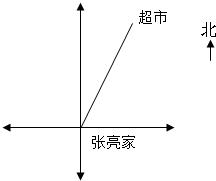

# Mathematics (Grade 6)

**ID**: fe74bdd0
**难度**: medium_hard
**题型**: multiple_choice

## 题目
图是张亮以家为观测点画出的平面图，超市在张亮家的位置是（  ）（说明：十字交点处为张亮家．比例尺1：20000．）
A．北偏东60度600米处
B．东偏北60度60000米处
C．北偏东30度600米处
D．东偏北30度60000米处

## 解答

**答案**: C

1. Step1:明确确定物体位置需要方向和距离两个条件，且生活中一般先说与物体所在方向离得较近（夹角较小）的方位
2. Step2:通过测量得出超市在张亮家北偏东30度方向
3. Step3:测量出超市到张亮家的图上距离为3厘米
4. Step4:根据公式实际距离=图上距离÷比例尺，计算出实际距离为3÷(1/20000)=60000厘米
5. Step5:将60000厘米换算为600米
6. Step6:得出超市在张亮家北偏东30度600米处，所以答案选C

## 知识点

**知识点**:
  - 根据方向和距离确定物体的位置．

---
