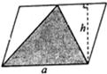

# Mathematics (Grade 6)

**ID**: ff1261dd
**难度**: medium_hard
**题型**: multiple_choice

## 题目
用字母表示阴影部分的面积是（  ）

$\begin{description}
\item A．ah\item B．ah+ah÷2\item C．ah÷2\item D．无法确定
\end{description}$

## 解答

**答案**: C

1. Step1:观察图形可知阴影部分是一个三角形
2. Step2:明确该三角形的底为a
3. Step3:明确该三角形的高为h
4. Step4:根据三角形面积公式S = 底×高÷2，可得其面积为a×h÷2，即ah÷2
5. Step5:对比选项，发现C选项符合，所以答案选C

## 知识点

**知识点**:
  - 三角形的周长和面积；用字母表示数．

---
