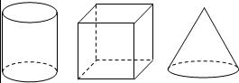

# Mathematics (Grade 6)

**ID**: ff38b040
**难度**: medium_hard
**题型**: multiple_choice

## 题目
(2009•资中县)图中的正方体、圆柱体和圆锥体的底面积相等，高也相等，下面说法正确的是(  )

A．圆锥的体积是正方体体积的三分之一
B．圆锥的体积是圆柱体积的3倍
C．圆柱的体积比正方体的体积小一些

## 解答

**答案**: A

1. Step1:明确圆柱体积公式为V=sh
2. Step2:明确正方体体积公式为V=sh
3. Step3:因为正方体和圆柱体底面积相等且高也相等，根据其体积公式可得正方体和圆柱体积相等
4. Step4:明确圆锥体积公式为V=1/3sh
5. Step5:由于正方体、圆柱体和圆锥体底面积相等且高也相等，所以圆锥体积是正方体体积的三分之一，也是圆柱体积的三分之一
6. Step6:分析选项A，圆锥的体积是正方体体积的三分之一，该选项正确
7. Step7:分析选项B，圆锥体积是圆柱体积的三分之一，不是3倍，该选项错误
8. Step8:分析选项C，圆柱体积和正方体体积相等，不是圆柱体积比正方体体积小一些，该选项错误
9. Step9:综上，正确答案是A

## 知识点

**知识点**:
  - 圆柱的侧面积、表面积和体积;长方体和正方体的体积;圆锥的体积．

---
