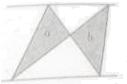

# Mathematics (Grade 6)

**ID**: ff90837c
**难度**: medium_hard
**题型**: multiple_choice

## 题目
如图a，b两部分阴影的面积（  ）

A．a＞b
B．a＜b
C．a=b

## 解答

**答案**: C

1. Step1:观察图形，发现a与下面空白三角形组成的大三角形和b与下面空白三角形组成的大三角形等底等高
2. Step2:根据等底等高的三角形面积相等，可知a与下面空白三角形的面积和等于b与下面空白三角形的面积和
3. Step3:等式两边同时减去下面空白三角形的面积，得到a的面积等于b的面积
4. Step4:根据选项，选择答案为C

## 知识点

**知识点**:
  - 面积及面积的大小比较．

---
