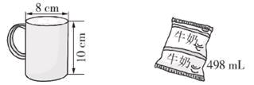

# Mathematics (Grade 6)

**ID**: 0115e51f
**难度**: medium_hard
**题型**: short_answer

## 题目
下面这个杯子能不能装下这袋牛奶？（杯子的厚度忽略不计）

## 解答

**答案**: 杯子能装下牛奶。

1. Step1:明确杯子可看作圆柱体，且厚度忽略不计，所以其容积等于体积，即容积=底面积×高
2. Step2:计算杯子底面半径为8÷2 = 4厘米
3. Step3:根据公式计算杯子的容积为3.14×4²×10 = 3.14×16×10 = 50.24×10 = 502.4立方厘米，502.4立方厘米 = 502.4毫升
4. Step4:已知牛奶体积为498毫升
5. Step5:比较杯子容积502.4毫升和牛奶体积498毫升的大小，因为502.4毫升＞498毫升，所以杯子能装下牛奶

## 知识点

**知识点**:
  - 

---
