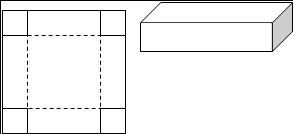

# Mathematics (Grade 6)

**ID**: 02635a96
**难度**: medium_hard
**题型**: short_answer

## 题目
将一块正方形铁片的四个角各剪去一个边长为2cm的小正方形，可折成一个无盖方盒，已知这个方盒的容积为128ml，求这个方盒的表面积．

## 解答

**答案**: 128

1. Step1:将容积单位进行换算，128ml换算为128立方厘米
2. Step2:根据长方体体积公式v = sh，已知高为2厘米，用容积128立方厘米除以高2厘米，求出底面积为128÷2 = 64平方厘米
3. Step3:由底面积为64平方厘米，因为8×8 = 64，得出底面边长是8厘米
4. Step4:计算方盒表面积，无盖方盒表面积为底面积加上四个侧面面积，即8×8 + 8×2×4 = 64 + 64 = 128平方厘米
5. Step5:得出方盒表面积为128平方厘米

## 知识点

**知识点**:
  - 长方体、正方体表面积与体积计算的应用

---
