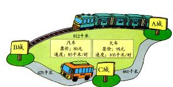

# Mathematics (Grade 6)

**ID**: 03290cd9
**难度**: medium_hard
**题型**: short_answer

## 题目

 (1)大伟一家三口人从B城坐火车去A城，往返一共要用多少钱？
 (2)小娜要从A城到B城去参加儿童歌唱比赛，必须在9小时内到达．你能帮她选择一种合适的交通工具吗？说说你的理由．

## 解答

**答案**: 570, 只能坐火车

1. Step1:计算大伟一家三口从B城坐火车去A城往返的费用，根据价钱=票价×人数×次数，已知火车票价为95元，人数是3人，往返次数为2次，所以费用为95×2×3=570元
2. Step2:计算A城到B城的公路距离，A城到C城距离为460千米，C城到B城距离为425千米，所以A,B两地距离为460+425=885千米
3. Step3:计算火车9小时行驶的距离，火车速度为105千米/时，根据路程=速度×时间，可得105×9=945千米，945千米＞812千米（A,B两地铁路距离812千米）
4. Step4:计算汽车9小时行驶的距离，汽车速度为85千米/时，根据路程=速度×时间，可得85×9=765千米，765千米＜885千米
5. Step5:比较火车和汽车9小时行驶距离与A,B两地距离，因为汽车9小时行驶距离小于A,B两地公路距离，火车9小时行驶距离大于A,B两地铁路距离，所以小娜只能坐火车

## 知识点

**知识点**:
  - --

---
