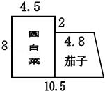

# Mathematics (Grade 6)

**ID**: 03b9279f
**难度**: medium_hard
**题型**: short_answer

## 题目
李大爷家有一块菜地．（形状如图，单位米）

长方形地里种的是圆白菜，右边的梯形地里种的是茄子．
（1）每棵圆白菜占地0.15平方米，一共可以种几棵？
（2）茄子地一共有多少平方米？

## 解答

**答案**: 240, 32.4

1. Step1:计算圆白菜地的面积，长方形面积公式为S=ab，其中a=8米，b=4.5米，所以圆白菜地面积为8×4.5 = 36平方米
2. Step2:用圆白菜地面积除以每棵圆白菜占地面积0.15平方米，即36÷0.15 = 240棵，得到圆白菜的种植数量
3. Step3:计算梯形茄子地的上底，上底为10.5 - 4.5 = 6米，下底为4.8米，高为8 - 2 = 6米
4. Step4:根据梯形面积公式S=(a + b)×h÷2，其中a=6米，b=4.8米，h=6米，所以茄子地面积为(4.8 + 6)×6÷2 = 32.4平方米

## 知识点

**知识点**:
  - 小学数学;数与代数;应用题;面积、体积相关应用题;长方形、正方形相关的应用题

---
