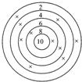

# Mathematics (Grade 6)

**ID**: 040a7718
**难度**: medium_hard
**题型**: short_answer

## 题目
阿奇参加射击比赛，他一共打了10枪，每枪都射中靶子，位置如图中的“×”．图中数字表示击中靶子各部位能得到的分数．请问：阿奇此次打靶的平均分是多少？

## 解答

**答案**: 4.8

1. Step1:明确阿奇打靶的总枪数为10枪
2. Step2:确定阿奇10枪对应的环数分别为8，8，6，6，4，4，4，4，2，2
3. Step3:计算总环数，即8+8+6+6+4+4+4+4+2+2=48
4. Step4:根据平均数公式，用总环数除以总枪数，即48÷10=4.8，得到平均分

## 知识点

**知识点**:
  - 平均数的含义及求平均数的方法．

---
