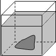

# Mathematics (Grade 6)

**ID**: 0606bff7
**难度**: medium_hard
**题型**: short_answer

## 题目
一个正方体玻璃容器棱长2分米，容器中水深l2厘米．把一块石头放入水中，这时量得容器内的水深15厘米．石头的体积是多少立方厘米？     

## 解答

**答案**: 1200

1. Step1:将正方体玻璃容器棱长的单位由分米换算为厘米，因为1分米 = 10厘米，所以2分米 = 20厘米
2. Step2:明确石头的体积等于放入石头后水上升的体积，水上升部分的形状为长方体
3. Step3:计算长方体的底面积，底面积为正方体容器的底面积，即20×20 = 400平方厘米
4. Step4:计算水上升的高度，15 - 12 = 3厘米
5. Step5:根据长方体体积公式V = 底面积×高，计算石头体积为400×3 = 1200立方厘米

## 知识点

**知识点**:
  - 探索某些实物体积的测量方法;长方体和正方体的体积．

---
