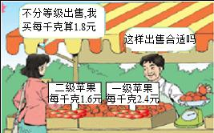

# Mathematics (Grade 6)

**ID**: 0c707090
**难度**: medium_hard
**题型**: short_answer

## 题目
水果店运进240千克苹果，其中一半达到一级质量标准，其余达到二级质量标准．如果你是售货员，你同意不分等级出售吗？为什么？

## 解答

**答案**: 120, 480, 432, 我不同意不分等级出售，因为不分等级出售收入少．

1. Step1:计算一级苹果和二级苹果的重量，240÷2 = 120（千克）
2. Step2:计算分等级出售的收入，1.6×120 + 2.4×120 = 192 + 288 = 480（元）
3. Step3:计算不分等级出售的收入，1.8×240 = 432（元）
4. Step4:比较分等级和不分等级出售的收入，480元＞432元，得出结论：我不同意不分等级出售，因为不分等级出售收入少．

## 知识点

**知识点**:
  - 图文应用题；整数、小数复合应用题．

---
