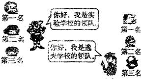

# Mathematics (Grade 6)

**ID**: 0cab8156
**难度**: medium_hard
**题型**: short_answer

## 题目
两个学校进行围棋比赛．
如果你是逸夫学校的领队，你怎样安排能保证获胜？(规定三局两胜为胜)
 $实验学校逸夫学校比赛胜者\\
第一场\\
第二场\\
第三场$

## 解答

**答案**: 实验学校, 逸夫学校, 逸夫学校

1. Step1:明确比赛规则为三局两胜制
2. Step2:借鉴田忌赛马策略，用己方第三名对阵对方第一名，故意输掉第一场，即第一场实验学校第一名对阵逸夫学校第三名，比赛胜者为实验学校
3. Step3:用己方第一名对阵对方第二名，赢得第二场，即第二场实验学校第二名对阵逸夫学校第一名，比赛胜者为逸夫学校
4. Step4:用己方第二名对阵对方第三名，赢得第三场，即第三场实验学校第三名对阵逸夫学校第二名，比赛胜者为逸夫学校
5. Step5:整理得出三场比赛对阵及胜者依次为实验学校、逸夫学校、逸夫学校

## 知识点

**知识点**:
  - 田忌赛马问题．

---
