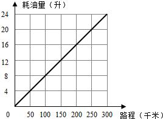

# Mathematics (Grade 6)

**ID**: 0fd5bf47
**难度**: medium_hard
**题型**: short_answer

## 题目
（图009•沙县）如图表示一辆汽车在高速公路上行驶的路程与耗油量的关系．沙县至福州的高速公路长大约图图0千米，如果这辆汽车走高速公路从沙县到福州，大约需要耗油多少升？

## 解答

**答案**: 17.6

1. Step1:观察折线统计图，根据解析2可知路程与耗油量成正比例关系
2. Step2:设从沙县到福州大约需要耗油x升
3. Step3:根据正比例关系列出比例式50:4 = 220:x
4. Step4:根据比例的基本性质，内项之积等于外项之积，得到50x = 220×4
5. Step5:计算220×4 = 880，此时方程为50x = 880
6. Step6:方程两边同时除以50，即x = 880÷50 = 17.6，得到耗油量为17.6升

## 知识点

**知识点**:
  - 单式折线统计图；简单的行程问题；从统计图表中获取信息．

---
