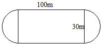

# Mathematics (Grade 6)

**ID**: 112869e9
**难度**: medium_hard
**题型**: short_answer

## 题目
绕体育场（如图）跑一周，一共要跑多少米？（结果保留整数）

## 解答

**答案**: 294

1. Step1:根据解析2可知，体育场两边弯道组成一个直径为30米的圆，根据圆的周长公式C = πd（其中C为周长，d为直径，π取3.14），可计算出弯道的长度为3.14×30 = 94.2米
2. Step2:已知体育场直道长度为100米，且有两条直道，所以直道总长度为100×2 = 200米
3. Step3:将弯道长度与直道总长度相加，可得绕体育场跑一周的长度为94.2 + 200 = 294.2米
4. Step4:题目要求结果保留整数，根据四舍五入原则，294.2米≈294米

## 知识点

**知识点**:
  - 圆、圆环的周长

---
