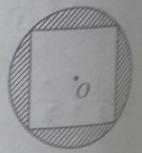

# Mathematics (Grade 6)

**ID**: 11791513
**难度**: medium_hard
**题型**: short_answer

## 题目
如图，已知正方形的面积是10平方厘米，求阴影部分的面积.

## 解答

**答案**: 5.7

1. Step1:设圆的半径为r，因为圆的直径等于正方形的对角线，所以正方形面积可表示为2r²，已知正方形面积是10平方厘米，即2r² = 10
2. Step2:由2r² = 10，计算得出r² = 5
3. Step3:根据圆的面积公式S = πr²，可得圆的面积为πr²，又因为阴影部分的面积 = 圆的面积 - 正方形的面积，所以阴影部分面积为πr² - 10
4. Step4:把r² = 5代入πr² - 10，且π取3.14，计算3.14×5 - 10 = 15.7 - 10 = 5.7，得出阴影部分面积为5.7平方厘米

## 知识点

**知识点**:
  - --

---
