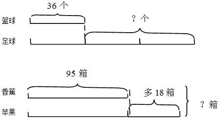

# Mathematics (Grade 6)

**ID**: 12848d3b
**难度**: medium_hard
**题型**: short_answer

## 题目
看图列式解答．

## 解答

**答案**: 72, 208

1. Step1:根据图可知足球个数是篮球的3倍，篮球有36个，所以足球个数为36×3=108个
2. Step2:求足球比篮球多的个数，用足球个数减去篮球个数，即108 - 36 = 72个
3. Step3:由图可知苹果的箱数比香蕉多18箱，香蕉有95箱，所以苹果箱数为95 + 18 = 113箱
4. Step4:求香蕉和苹果总箱数，将苹果箱数和香蕉箱数相加，即113 + 95 = 208箱

## 知识点

**知识点**:
  - 图文应用题

---
