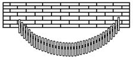

# Mathematics (Grade 6)

**ID**: 16b2b88a
**难度**: medium_hard
**题型**: short_answer

## 题目
李大爷靠墙围了一个半径为4米的半圆形菜地，在菜地的周围围上竹篱笆。竹篱笆长多少米？用菜地的$\frac{1}{2}$种白菜，种白菜的面积是多少平方米？

## 解答

**答案**: 12.56, 12.56

1. Step1:根据圆的周长公式$C = 2\pi r$，求半圆的弧长，半径$r = 4$米，半圆的弧长为$3.14×4 = 12.56$米，此为竹篱笆的长度
2. Step2:根据圆的面积公式$S = \pi r^{2}$，先求出整个圆的面积为$3.14×4^{2}=50.24$平方米，因为菜地是半圆，所以菜地面积为$50.24÷2$，又因为种白菜的面积是菜地的$rac{1}{2}$，即种白菜的面积是整个圆面积的$rac{1}{4}$，所以种白菜的面积为$50.24÷4 = 12.56$平方米

## 知识点

**知识点**:
  - 小学数学;数与代数;应用题;面积、体积相关应用题;圆相关的应用题

---
