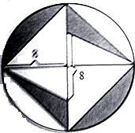

# Mathematics (Grade 6)

**ID**: 1825f005
**难度**: medium_hard
**题型**: short_answer

## 题目
计算图中阴影部分的面积．（单位：cm）

## 解答

**答案**: 68.48

1. Step1:明确阴影部分面积的组成，根据题意可知阴影部分的面积是两组（$rac{1}{4}$圆的面积 - 小三角形面积）
2. Step2:计算$rac{1}{4}$圆的面积，已知圆的半径为8cm，根据圆的面积公式$S = \pi r^2$，可得$rac{1}{4}$圆的面积为$rac{1}{4}×3.14×8^{2}=3.14×16$平方厘米
3. Step3:计算小三角形的面积，三角形的两条直角边为8cm和4cm，根据三角形面积公式$S = rac{1}{2}ah$，可得小三角形面积为$rac{1}{2}×4×8 = 16$平方厘米
4. Step4:计算一组（$rac{1}{4}$圆的面积 - 小三角形面积）的值，即$3.14×16 - 16 = (3.14 - 1)×16 = 2.14×16$平方厘米
5. Step5:计算阴影部分的面积，因为阴影部分是两组（$rac{1}{4}$圆的面积 - 小三角形面积），所以阴影部分面积为$2.14×16×2 = 68.48$平方厘米

## 知识点

**知识点**:
  - 组合图形的面积

---
