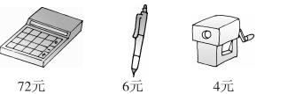

# Mathematics (Grade 6)

**ID**: 18bbe144
**难度**: medium_hard
**题型**: short_answer

## 题目

①计算器的价钱是圆珠笔的多少倍？
②买一个计算器的钱可以买多少个消笔器？

## 解答

**答案**: 12, 18

1. Step1:对于问题①，求计算器价钱是圆珠笔的多少倍，已知计算器72元，圆珠笔6元，根据除法意义，用计算器价钱除以圆珠笔价钱，即72÷6=12
2. Step2:对于问题②，求买一个计算器的钱可买多少个削笔器，已知计算器72元，削笔器4元，根据除法意义，用计算器价钱除以削笔器价钱，即72÷4=18

## 知识点

**知识点**:
  - 一位数除两、三位数

---
